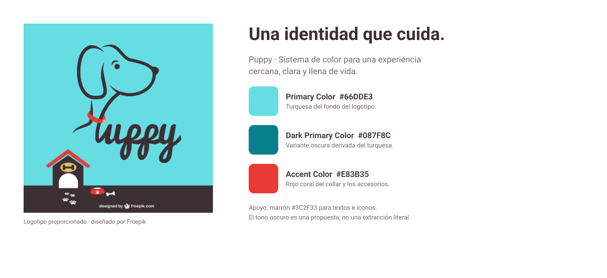
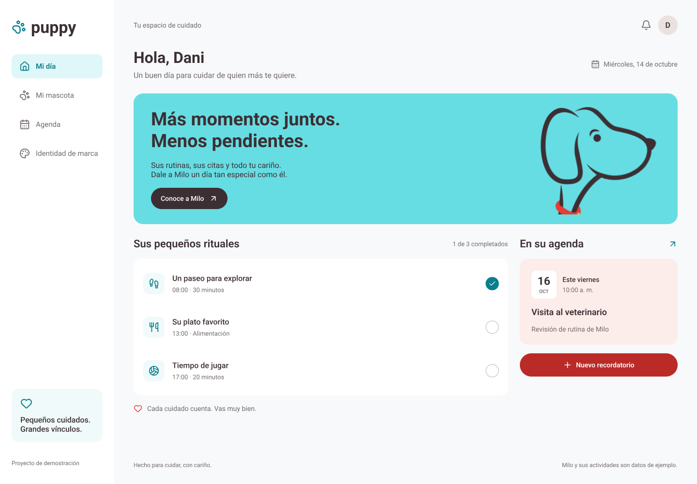
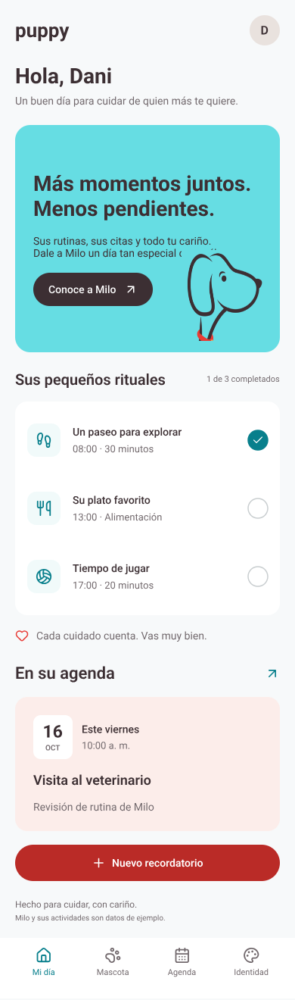
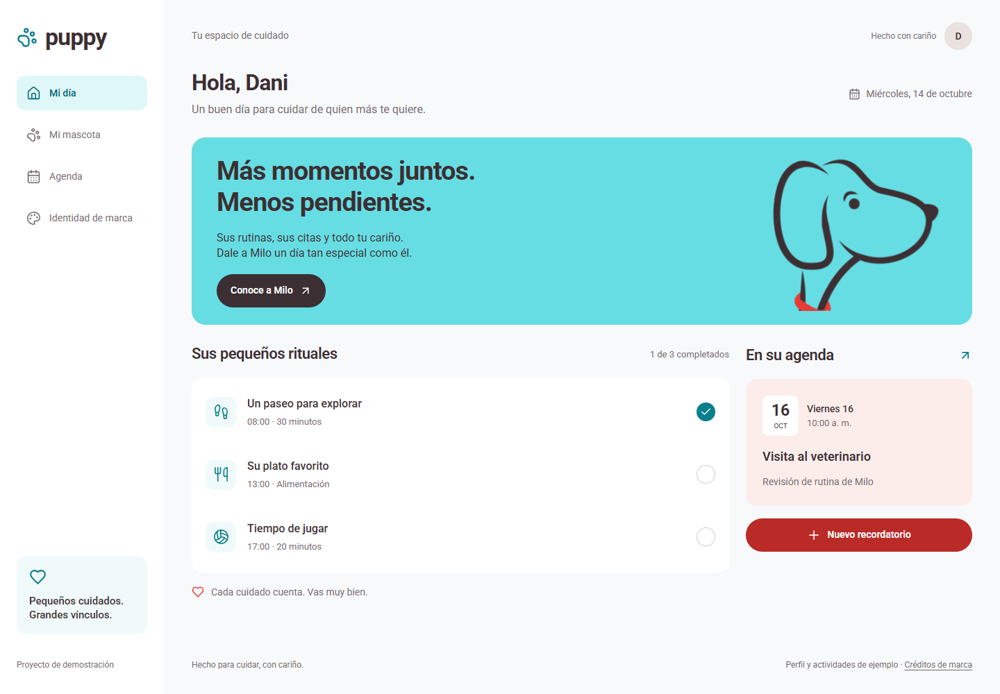
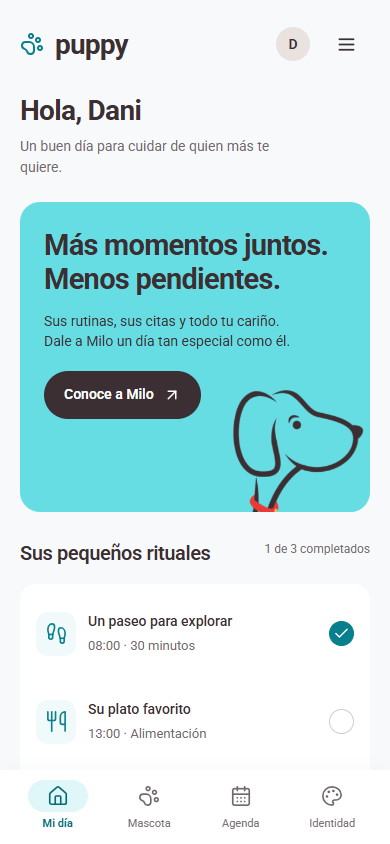

# Puppy

**Una identidad que cuida.**

A partir del logotipo y las referencias de la actividad, se creó una identidad corporativa para Puppy y se aplicó a una experiencia digital de cuidado de mascotas. El resultado reúne rutinas, recordatorios y un perfil personal en un espacio cercano, claro y fácil de recorrer.

## Concepto de la propuesta

**«Pequeños cuidados. Grandes vínculos.»** es la idea que conecta la marca con la aplicación. El cuidado se representa a través de acciones cotidianas: salir a pasear, preparar su alimento, compartir un momento de juego o recordar una cita.

La interfaz convierte esas acciones en una organización sencilla del día. La bienvenida establece un tono afectuoso; las rutinas permiten reconocer lo que ya se hizo; y la agenda mantiene visibles los próximos compromisos. El personaje del logotipo acompaña esta experiencia y conserva el vínculo visual con la referencia de la actividad.

La personalidad de Puppy se expresa en tres cualidades:

- **Cercanía:** mensajes cotidianos y una comunicación centrada en el vínculo con la mascota.
- **Claridad:** jerarquías visibles, navegación directa y acciones fáciles de identificar.
- **Vitalidad:** el turquesa y el coral aportan energía a una composición de superficies claras.

## Identidad cromática

Con base en los colores del logotipo, se definieron los tres roles solicitados en la actividad. El turquesa funciona como color principal, su variante oscura organiza los estados de la interfaz y el coral introduce los acentos.

| Rol | Color | Aplicación en la propuesta |
| --- | --- | --- |
| **Primary Color** | `#66DDE3` | Turquesa del fondo del logotipo. Identifica la marca y ocupa el bloque de bienvenida. |
| **Dark Primary Color** | `#087F8C` | Variante oscura desarrollada a partir del turquesa. Define iconos y estados activos. |
| **Accent Color** | `#E83B35` | Coral de los accesorios del logotipo. Destaca detalles y acciones relevantes. |
| Texto y apoyo | `#3C2F33` | Marrón del contorno y la palabra Puppy. Aporta continuidad entre el logotipo y la tipografía de la interfaz. |

Dark Primary Color es una variante creada para completar el sistema visual; no corresponde a un color extraído literalmente de la imagen.

Para mantener la legibilidad, el sistema incorpora dos tonos funcionales: `#BA2B27` en botones coral con texto blanco y `#066B76` en textos pequeños sobre superficies turquesa claras. Estas variantes permiten conservar la identidad en distintos componentes.



## Diseño de la experiencia

La propuesta se desarrolló en Pen como un panel de cuidado diario. Su composición establece un recorrido desde el saludo y el mensaje de marca hacia las rutinas y los recordatorios.

### Vista de escritorio

La navegación lateral mantiene disponibles las cuatro secciones. El contenido principal distribuye las rutinas y la próxima cita en dos columnas, de modo que las acciones del día y los compromisos se consultan en un mismo espacio.



### Vista móvil

En móvil, el contenido se organiza en una columna y conserva el mismo orden de lectura. La navegación inferior facilita el acceso a las secciones, mientras las filas de rutinas y los botones mantienen un tamaño cómodo para la interacción táctil.



## Aplicación de Material Design

Las referencias de la actividad se concretaron en un sistema visual con colores por función, superficies diferenciadas y componentes consistentes.

- **Jerarquía:** el saludo, el mensaje principal, los títulos de sección y los detalles de cada actividad tienen niveles tipográficos diferenciados.
- **Superficies:** los fondos claros separan el espacio de trabajo, las rutinas y los recordatorios sin recargar la composición.
- **Estados:** el turquesa identifica la navegación seleccionada y las rutinas completadas; cada estado también se reconoce mediante iconos o texto.
- **Acciones:** los botones presentan verbos concretos, como guardar, completar o añadir un recordatorio.
- **Tipografía:** Roboto unifica títulos, textos y controles para mantener una lectura consistente.
- **Accesibilidad:** el diseño incorpora foco visible, etiquetas en los formularios, contraste en las acciones y respeto por la preferencia de movimiento reducido.

## Funcionalidades

La identidad se aplica a cuatro secciones que organizan la experiencia:

| Sección | Propósito |
| --- | --- |
| **Mi día** | Consultar las rutinas, marcar los cuidados completados y revisar el siguiente recordatorio. |
| **Mi mascota** | Personalizar el nombre, la raza, el cumpleaños y los favoritos de la mascota. |
| **Agenda** | Crear, completar, reabrir, filtrar y eliminar recordatorios. |
| **Identidad de marca** | Consultar los colores corporativos y descargar los recursos visuales de la propuesta. |

El nombre guardado en el perfil se refleja en la bienvenida, conectando la personalización con el resto de la experiencia.

## Resultado implementado

El diseño de Pen se llevó a una aplicación adaptable a escritorio, tablet y móvil, manteniendo la paleta, la jerarquía y la organización del panel.

### Aplicación en escritorio



### Aplicación en móvil



## Datos de la aplicación

Milo y sus actividades constituyen el contenido inicial de ejemplo y pueden personalizarse. Los cambios se guardan en el navegador mediante `localStorage`. Las rutinas se reinician cada día según la zona `America/Bogota`.

La agenda permite registrar compromisos y consultarlos dentro de la aplicación. Los datos permanecen en el navegador utilizado, sin sincronización entre dispositivos ni envío de notificaciones.

## Ejecutar el proyecto

La implementación utiliza Next.js, TypeScript y Tailwind CSS. Requiere Node.js **20.9 o superior** y npm.

```bash
npm ci
npm run dev
```

Abre [Puppy en localhost](http://127.0.0.1:3000).

No se necesitan variables de entorno, credenciales ni base de datos.

### Comandos para la validación final

```bash
npm run typecheck
npm run test:e2e
npm run build
npm start
```

Las pruebas E2E utilizan Google Chrome instalado. Su configuración se encuentra en [`playwright.config.ts`](playwright.config.ts).

## Organización del proyecto

```text
app/                 Rutas de la aplicación y tema visual
components/          Interfaz y estado compartido
lib/puppy.ts         Tipos, fechas y validación de datos
public/assets/       Logotipo de referencia
public/design/       Exportaciones finales de Pen
docs/design/         Archivos de la propuesta visual
docs/screenshots/    Capturas de la aplicación
tests/               Pruebas de los flujos principales
```

Los colores del tema se definen en [`app/globals.css`](app/globals.css) y permiten aplicar la identidad mediante clases como `bg-primary`, `text-primary-dark` y `bg-accent-strong`.
